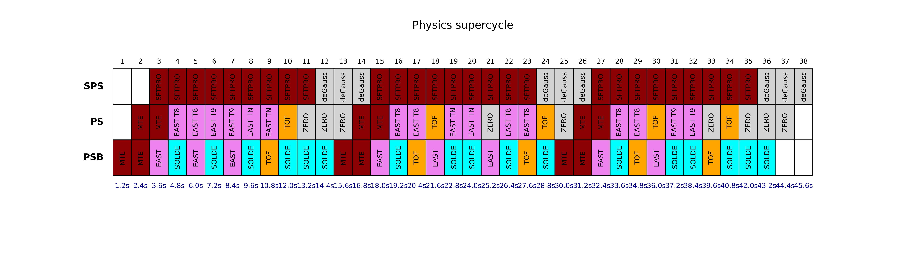

# Supercycles Modeling and Beam Sharing in the CERN Injectors

A Python package for modeling, analyzing, and optimizing the scheduling of cycles and supercycles in the CERN proton injector complex (PSB, PS, and SPS). It provides tools to describe and simulate how beam time is distributed across multiple facilities, both for present configurations and for planning future scenarios.

It includes tools for:
- Defining and editing supercycle structures for PSB, PS, and SPS.
- Estimating time-sharing and proton delivery to experiments.
- Visualizing supercycle usage with facility-level breakdowns.

<br/>

**Contact for corrections & suggestions**: [tirsi.prebibaj@cern.ch](mailto:tirsi.prebibaj@cern.ch)  


## Installation

```
pip install git+https://github.com/tprebiba/supercycles.git
```

## Requirements

- Python ≥ 3.8  
- Dependencies:
  - `numpy`
  - `scipy`
  - `pandas`
  - `matplotlib`

## Examples

See some usage examples in the [`examples/`](https://github.com/tprebiba/supercycles/tree/main/examples) folder.


## Relevant presentations and notes

- **SPS Operation and Future Proton Sharing Scenarios for the ECN3 facility**  
  [CERN-PBC-NOTE 2023001](https://cds.cern.ch/record/2848908/files/CERN-PBC-Notes-2023-001.pdf)

- **Proton sharing in the injector complex post LS3**, Chamonix Workshop 2025  
  [Online access (restricted)](https://indi.to/RT4HJ)
