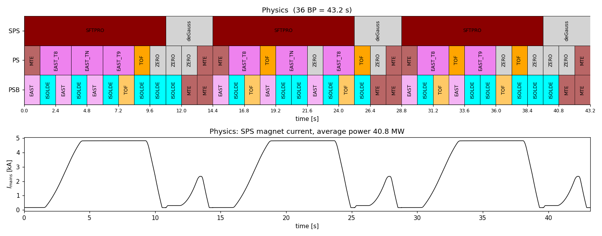
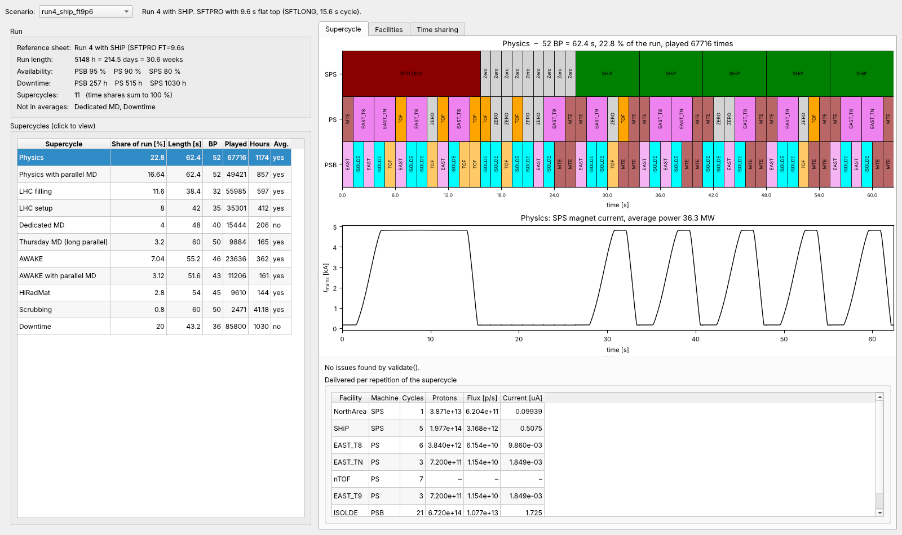

# Supercycles Modeling and Beam Sharing in the CERN Injectors

A Python package for modeling the supercycles of the CERN proton injector complex (PSB, PS and SPS):
how the basic periods are shared between cycles, how a run is shared between supercycles, and what
each facility receives. A small GUI displays a scenario and its numbers.

<br/>

**Contact for corrections & suggestions**: [tirsi.prebibaj@cern.ch](mailto:tirsi.prebibaj@cern.ch)


## Installation

```
pip install git+https://github.com/tprebiba/supercycles.git
```

Requirements: Python ≥ 3.8, `numpy`, `scipy`, `pandas`, `matplotlib`, `pyyaml`. The GUI also needs
one Qt binding (PyQt5, PyQt6 or PySide6): `pip install PyQt6`, or install the package with its
`gui` extra, e.g. `pip install -e ".[gui]"` from the repository root.


## Structure

```
supercycles/
    catalogue.py               Catalogue, CycleType, Beam, Injection, Facility, Machine
    supercycle.py              Supercycle, Placement, Issue, PlacementError
    schedule.py                Schedule: time sharing of a run, cycles / protons / currents over the run
    plotting.py                plot_supercycle, plot_magnet_current
    gui.py                     scenario viewer (Qt)
    data/catalogue/*.yaml      machines & limits, facilities, cycle types of PSB / PS / SPS
    data/profiles/*.csv        SPS magnet current profiles
scenarios/                     one module per scenario of the reference spreadsheet (see below)
examples/                      01_catalogue, 02_build_supercycle, 03_checks_and_deliverables,
                               04_plotting, 05_scenarios
```

### Catalogue
All data lives in YAML files, not in the code. Every cycle type has a unique key `MACHINE.id`
(e.g. `SPS.SFTPRO`), a length in basic periods (1 BP = 1.2 s), its beam (destination facility,
intensity, transmission) and an explicit list of the upstream cycles injecting into it:

```yaml
- id: SFTPRO
  length_bp: 9
  average_power_MW: 52.83
  profile: SFTPRO1_10point8.csv
  beam: {destination: NorthArea, intensity: 4.2e+13, transmission: 0.92169}
  injections:
    - {cycle: PS.MTE, bp_offset: -1}     # relative to the start of the SFTPRO cycle
    - {cycle: PS.MTE, bp_offset: 0}
```

Unknown fields (typos), unknown destinations, missing profile files and injections from the wrong
machine are rejected when the catalogue is loaded.

Each machine also has a 1-BP `Downtime` cycle type (`downtime: true`, no beam), used to block BPs
without beam. A scenario can change a beam without touching the files:
`load_catalogue().with_beam('SPS.SHiP', intensity=5.2e13)` returns a modified copy.

### Supercycle
- Fixed period in BP, common to all machines. The supercycle repeats: BP 0 is the last BP of the
  previous repetition (wrap-around), so the injections of the first SPS cycle sit at the end of the
  PS and PSB sequences, as in operation.
- The only stored state is the list of placements (cycle type, start BP, parent). Timelines, counts,
  power and fluxes are computed from it.
- `add()` places the injections recursively and either succeeds completely or changes nothing.
  `remove()` takes the injections along.
- `validate()` returns the problems found: length limit, SPS power limit, free BPs, missing injections.

```python
from supercycles import Supercycle

sc = Supercycle('Physics', period_bp=36)
sc.add('SPS', 'SFTPRO', 1)      # + 2x PS.MTE (BP 36, 1) + 2x PSB.MTE (BP 35, 36)
sc.add('SPS', 'deGauss')        # right after the previous SPS cycle
sc.fill('PSB', 'ISOLDE')        # every free PSB BP
print(sc)                       # text grid
sc.validate()                   # [] if everything is fine
sc.facility_table()             # cycles, protons, flux and current per facility
```


## Scenarios

Each module of `scenarios/` rebuilds one sheet of the reference spreadsheet
(`../reference_docs/beam_sharing_table_example.xlsx`) with the `Supercycle` API:

| Module | Sheet |
|---|---|
| `run3` | Run 3 (no SHiP, SFTPRO FT=4.8s) |
| `run4_ship_ft4p8` | Run 4 with SHiP (SFTPRO=4.8s) |
| `run4_ship_ft9p6` | Run 4 with SHiP (SFTPRO FT=9.6s) |
| `run4_ship_ft9p6_pushed_sps_power` | Run 3 with SHiP (SFTPRO FT=9.6s): same as above with fewer SPS Zero cycles, SPS power at its limit |
| `run4_ship_5p2e13_ft9p6` | Run 4 with 5.2e13 SHiP (SFTPRO FT=9.6s) |

A module defines `SHEET`, `CATALOGUE` (with any scenario-specific assumption, e.g.
`load_catalogue().with_beam('SPS.SHiP', intensity=5.2e13)`), `RUN_LENGTH_HOURS`,
`SPS_AVAILABILITY`, `TIME_SHARES` (% of the run, written as in the sheet: `38.8 * SPS_AVAILABILITY`,
plus `'Downtime': 100 * (1 - SPS_AVAILABILITY)`), `NOT_IN_AVERAGES`, one function per
supercycle and `supercycles()`. `scenarios.ALL` lists them all.

Downtime is modelled as in the sheet, as a temporary solution: a 'Downtime' supercycle made of
1-BP `Downtime` cycles (no beam). There the SPS is down all the time, the PS half and the PSB a
quarter of the time, which gives an availability of 80 % / 90 % / 95 % for SPS / PS / PSB.

All 55 supercycles reproduce the sheet BP by BP. Places where the sheet is inconsistent (a PS
cycle without its PSB injection, a PSB injection used by no PS cycle, a supercycle length that is
not a whole number of BPs) are commented in the scenario files.


## Schedule and scenario viewer

`Schedule` shares a run between the supercycles of a scenario, as the spreadsheet does: each
supercycle is played  run length x share / length  times. It gives the availability of each
machine (from the downtime cycles), and per facility the cycles and protons over the run (all
supercycles) and the average flux and current (without the `NOT_IN_AVERAGES` supercycles, e.g.
Dedicated MD and Downtime). The times played, yearly cycles, POT and averaged currents agree with
the sheets. AD (fixed 110 s period, taking some EAST T8 slots) is not modelled yet.

```python
import scenarios
from supercycles import Schedule

schedule = Schedule.from_scenario(scenarios.run4_ship_ft9p6)
schedule.availability('PS')        # 0.9
schedule.availability_table()      # availability and downtime hours per machine
schedule.supercycle_table()        # share of the run, length, repetitions, hours per supercycle
schedule.cycle_table()             # cycles played per cycle type, per run and per day
schedule.facility_table()          # cycles, protons, average flux and current per facility
schedule.per_supercycle_table()    # cycles of each facility per supercycle
```

The scenario viewer (`supercycles/gui.py`) only displays: all numbers come from `Supercycle` and
`Schedule`. It shows the run settings and the availability of each machine, the list of
supercycles (click one to plot it with the SPS magnet current, its `validate()` result and what it
delivers), the facility numbers per supercycle and over the run, and the time sharing.

```
python -m supercycles.gui                   # from the repository root
python -m supercycles.gui run4_ship_ft9p6   # open a given scenario
```

It needs one Qt binding: `pip install PyQt6` (PyQt5 and PySide6 work too).

<br/>


## Relevant presentations and notes

- **SPS Operation and Future Proton Sharing Scenarios for the ECN3 facility**
  [CERN-PBC-NOTE 2023001](https://cds.cern.ch/record/2848908/files/CERN-PBC-Notes-2023-001.pdf)

- **Proton sharing in the injector complex post LS3**, Chamonix Workshop 2025
  [Online access (restricted)](https://indi.to/RT4HJ)
